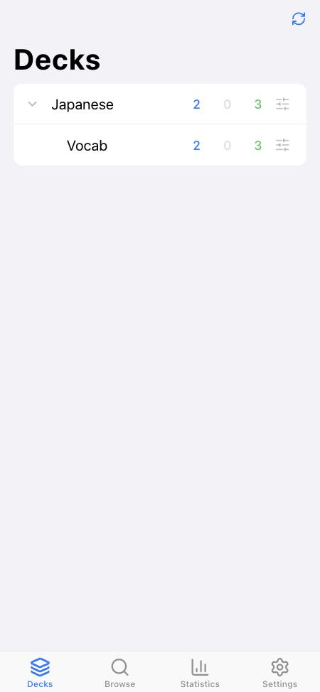
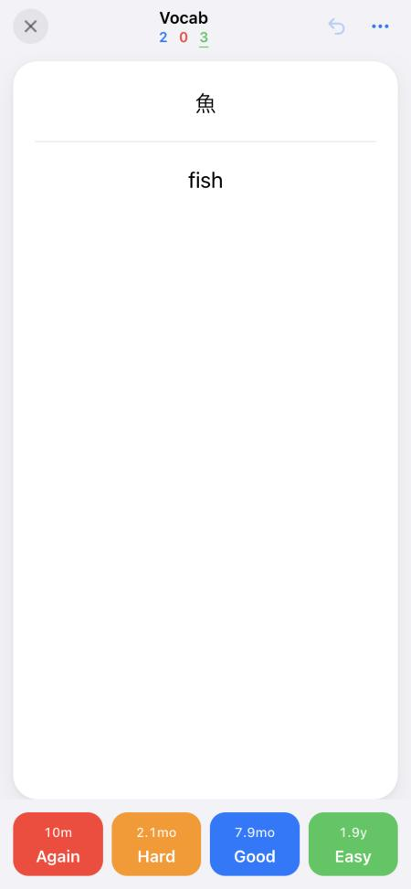
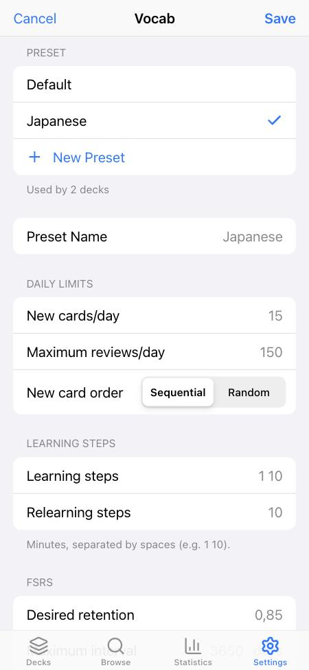
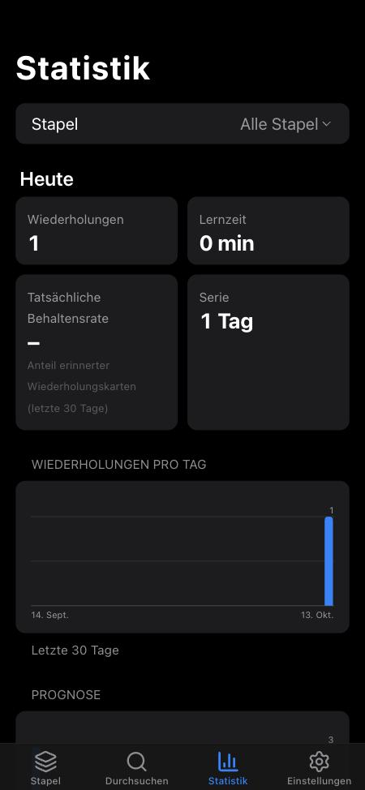

# Kuru

> A modern, offline-first spaced repetition PWA — Anki-compatible, powered by FSRS-6.

Kuru (クル, from 繰る — *"to turn (pages)"*) is a self-hosted spaced repetition system with an iOS-native look and feel.
It imports your existing Anki collections (`.apkg` / `.colpkg`) **including the complete review
history**, so you keep every bit of progress, and schedules reviews with the modern
[FSRS](https://github.com/open-spaced-repetition) algorithm — on the server *and* on your device,
so reviewing works without a connection.

<p align="center">
  
  
  
  
</p>

## Features

- **Lossless Anki import** — note types, templates, decks, presets, media and the full `revlog` from
  every Anki package generation (`anki2`, `anki21`, and zstd/protobuf `anki21b`). Due dates, learning
  steps, suspension and FSRS memory state carry over; re-imports update without duplicating.
- **FSRS-6 scheduling** — `py-fsrs` on the server, `ts-fsrs` on the device, with deterministic interval
  fuzz shared by both so offline answers match the server bit for bit. Parameter optimisation from
  your review history (optional).
- **Offline-first PWA** — installable; the app shell, all pages, your cards and media are cached.
  Answers go to an IndexedDB outbox and sync (idempotently, in chronological order) when the server
  is reachable again.
- **iOS Human Interface Guidelines** — grouped lists, segmented controls, collapsing large titles, tab
  bar, spring card flips, dark mode, safe areas.
- **Anki-level deck options** — daily limits, new card order, (re)learning steps, desired retention,
  maximum interval, FSRS weights, sibling burying, audio autoplay, auto-reveal timer.
- **Card browser & statistics** — offline full-text search, card info with review history, true
  retention, forecast, stability/difficulty distributions.
- **English & German** — follows your system language, overridable in Settings.
- **Template rendering** — Anki template syntax incl. cloze, type-in answers, furigana, `[sound:]`;
  deck CSS isolated in a Shadow DOM; extensible through [rendering plugins](docs/plugins.md).

## Quickstart (Docker)

```bash
git clone <your fork or this repository> kuru && cd kuru
docker compose up -d --build
```

Open <http://localhost:3000>, go to **Settings → Import Anki Collection** and choose a file exported
from Anki via *File → Export* ("Anki Collection Package" or "Anki Deck Package", with scheduling
information and media).

To require a password-like access token, start the stack with `KURU_ACCESS_TOKEN=… docker compose up -d`.
See [deployment](docs/deployment.md) for configuration, HTTPS and backups.

> Service workers need a secure context: use `localhost` or serve Kuru over HTTPS.

## Development

Requirements: Python ≥ 3.13 with [uv](https://docs.astral.sh/uv/), Node.js ≥ 22 with [pnpm](https://pnpm.io/).

```bash
# terminal 1 — API on http://127.0.0.1:8000 (OpenAPI docs at /docs)
cd backend && uv sync && uv run kuru serve --reload

# terminal 2 — app on http://localhost:3000
cd frontend && pnpm install && pnpm dev

# all checks (what CI runs)
scripts/check.sh
```

The service worker is only registered in production builds (`pnpm build && pnpm start`).

## Documentation

| Topic | |
| --- | --- |
| Architecture overview | [docs/architecture.md](docs/architecture.md) |
| Offline sync protocol | [docs/sync.md](docs/sync.md) |
| Anki import internals | [docs/importer.md](docs/importer.md) |
| FSRS scheduling | [docs/fsrs.md](docs/fsrs.md) |
| HTTP API | [docs/api.md](docs/api.md) |
| Internationalisation | [docs/i18n.md](docs/i18n.md) |
| Rendering plugins | [docs/plugins.md](docs/plugins.md) |
| Deployment | [docs/deployment.md](docs/deployment.md) |
| Architecture decisions | [docs/adr](docs/adr/README.md) |
| Roadmap | [docs/roadmap.md](docs/roadmap.md) |
| Original design document | [CLAUDE.md](CLAUDE.md) |

## Project layout

```
backend/    FastAPI service: SQLite (SQLModel + Alembic), FSRS engine, Anki importer, sync API
frontend/   Next.js PWA: iOS design system, IndexedDB, service worker, template renderer
shared/     Test vectors shared by both test suites (FSRS parity)
docs/       Documentation and ADRs
```

## Contributing

Contributions are welcome — please read [CONTRIBUTING.md](CONTRIBUTING.md).

## Acknowledgements

Kuru stands on the shoulders of [Anki](https://apps.ankiweb.net/) and the
[Open Spaced Repetition](https://github.com/open-spaced-repetition) community (FSRS, `py-fsrs`,
`ts-fsrs`). Kuru is an independent project and not affiliated with Anki or AnkiWeb.

## License

[MIT](LICENSE)
